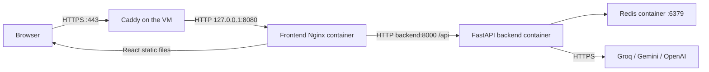
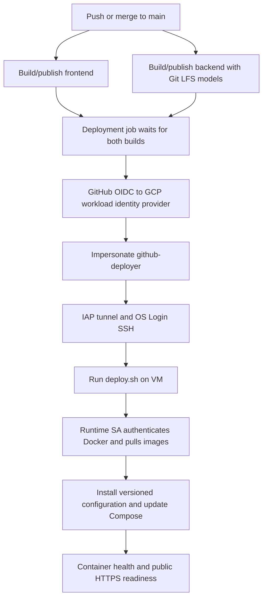

# Deployment architecture

## Request path

DNS maps `optiroutee.tech` to the VM's reserved external IPv4 address. Caddy
terminates TLS and automatically redirects HTTP to HTTPS. It proxies to the
loopback-only published frontend port. Nginx serves the React build and forwards
`/api/` requests to FastAPI on Docker's internal network. Backend and Redis
ports are not published on the host. Frontend API calls use relative `/api`
URLs, so the browser sees one origin and the backend has no CORS middleware.

Chat responses use Server-Sent Events over a streaming HTTP response. Nginx
buffering/caching is disabled for API responses, with a 300-second read timeout.
The local classifier/router run in the backend; generation in the current demo
uses hosted APIs, not Ollama on the VM.

## Proxy trust and Docker addresses

The production Docker bridge is `optiroute_default`, subnet `172.18.0.0/24`, with
gateway `172.18.0.1`. Host-side traffic to the published frontend port arrives
at Nginx from this gateway. These are Docker addresses, separate from the GCP
VPC's internal addresses.

| Hop | Configuration |
| --- | --- |
| Caddy to Nginx | `deploy/nginx-trusted-proxy.conf` trusts forwarded visitor IPs only from the Docker gateway. |
| Original scheme | `deploy/nginx-forwarded-scheme.map` accepts HTTP/HTTPS scheme headers from that original peer, before real-IP rewriting. |
| Nginx to backend | Frontend has fixed Docker address `172.18.0.10`; Uvicorn's `FORWARDED_ALLOW_IPS` trusts that address. |

Visitor-IP rewriting changes Nginx's request information, not the container's
own network address. Preserving the original scheme lets FastAPI produce HTTPS
URLs when it redirects, such as `/api/ready/` to `/api/ready`. Caddy's HTTP-to-HTTPS
redirect is a separate operation. The mounted trust files are production-only;
Nginx otherwise falls back to the connection's own scheme.

## Containers and state

| Service | Image source | Memory ceiling | CPU ceiling |
| --- | --- | --- | --- |
| Frontend | Node build, Nginx runtime | 128 MiB | 0.25 |
| Backend | Python 3.11, CPU PyTorch and packaged ML models | 2 GiB | 1.5 |
| Redis | `redis:8.8` | 512 MiB | 0.25 |

These are limits, not preallocated reservations. They exclude the host OS,
Caddy, Docker, page cache, and build/pull overhead. The backend uses one Uvicorn
worker. Compose orders Redis readiness before backend startup, then backend
readiness before frontend startup. `init: true` forwards signals/reaps backend
child processes; the backend has a 60-second stop grace period.

React keeps the session UUID and UI conversation in memory. Refreshing creates
a new session, so the previous conversation is no longer attached to that UI.
Redis retains the old session until its inactivity TTL expires (default 24
hours); refreshing does not immediately delete it from Redis. Semantic cache
entries have a separate default one-hour TTL. Redis disables RDB/AOF persistence
and uses tmpfs for `/data`, so restarting Redis loses sessions and cache.

## Build and deployment path

Both application images are tagged with the full Git commit SHA. The workflow
keeps one active production run, does not cancel it for new pushes, and skips
a commit that is no longer the `main` head at its pre-deployment check. The
VM script also has a filesystem lock for manual/automated deployment overlap.

The workflow transfers exactly two Compose files, two proxy files, and
`deploy.sh`. It does not transfer environment files or GitHub's generated GCP
credentials. The VM obtains fresh registry credentials from its own metadata
service and deletes its temporary Docker login configuration after deployment.
Images are downloaded before installing configuration/changing containers.

This is a single-VM deployment: container replacement can interrupt requests.
Public readiness checks infrastructure reachability, not a paid model response.
There is no release-history snapshot or rollback workflow.

## Identity boundaries

| Identity | Purpose and scope |
| --- | --- |
| Human project owner | One-time cloud setup and administration. |
| `github-deployer` | OIDC-based image publishing and administrator SSH access to this deployment VM. |
| `optiroute-runtime` | Attached to the VM; Artifact Registry Reader on the `optiroute` repository. |

The workload identity provider accepts this GitHub owner ID, repository ID, and
`refs/heads/main`. Its pool identifies trusted external workloads; its provider
validates GitHub tokens/maps claims; the service-account binding permits that
repository identity to impersonate `github-deployer`.

IAP permission opens the SSH tunnel. OS Admin Login permits Linux login and sudo.
The custom discovery role grants three read-only Compute permissions used by
gcloud. Service Account User on the attached runtime account provides `actAs`,
required for this login path. Administrator access to Docker also permits
reading VM files and using its runtime credentials; the permitted deployment
workflow is trusted administrator code.
